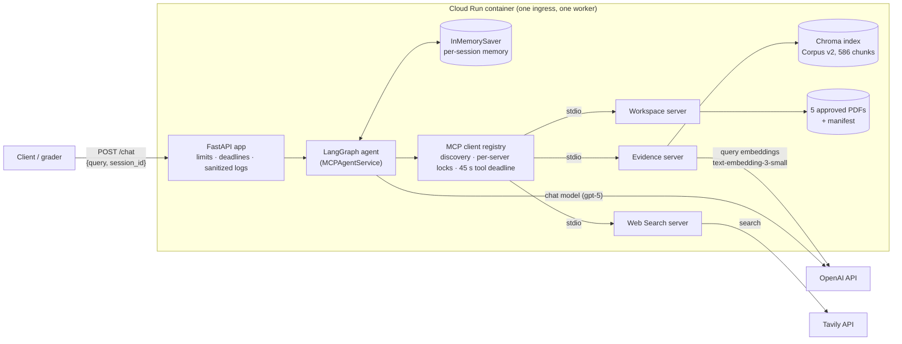
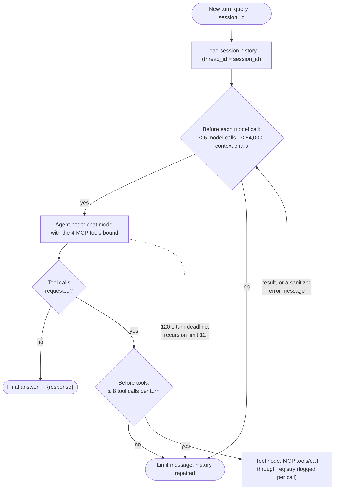
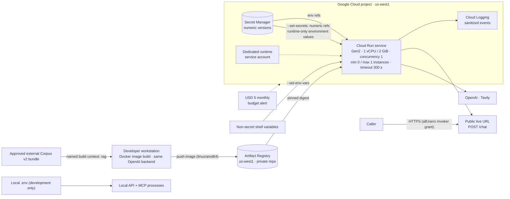

# Veridex

Veridex is an evidence-grounded research assistant built for CSCI 599 Assignment 1. A
LangGraph agent answers questions about a small, licensed corpus of research papers.
It gets its tools at runtime from **three independent Model Context Protocol (MCP)
servers**: local semantic retrieval, live web search, and read-only document access.
It cites document IDs and PDF pages, keeps conversation memory per session, and is
served over HTTP as one `POST /chat` endpoint on Google Cloud Run.

> **Deployment status (2026-10-13):** the Cloud Run service is publicly invokable.
> Public API: **https://veridex-staging-200331083905.us-west1.run.app/chat**
> Anonymous smoke test: HTTP 200 with the exact JSON response contract. The planned
> public window ends December 14, 2026; revocation is manual and not scheduled.
> Use nonconfidential inputs; caller-selected session IDs do not establish ownership.

## Contents

- [Architecture](#architecture)
- [MCP servers and tools](#mcp-servers-and-tools)
- [Agent workflow and memory](#agent-workflow-and-memory)
- [API contract](#api-contract)
- [Local setup](#local-setup)
- [Testing](#testing)
- [Cloud Run deployment](#cloud-run-deployment)
- [Costs](#costs)
- [Corpus licensing and attribution](#corpus-licensing-and-attribution)
- [Limitations](#limitations)
- [Project structure](#project-structure)
- [Further documentation](#further-documentation)

## Architecture



- **FastAPI** (`src/veridex/api/`) validates requests strictly, limits body size, admission and
  total request time, and turns internal failures into safe status codes. It never returns
  provider or exception details.
- **LangGraph agent** (`src/veridex/agent/`) lets the model choose tools, with limits on tool
  and model calls per turn, a 120-second turn deadline, and conversation-history repair if a
  turn is interrupted.
- **MCP client** (`src/veridex/mcp/client.py`) starts the three servers as persistent stdio
  subprocesses, discovers their tools at startup, and fails closed unless exactly the four
  expected tools are present.
- **Sanitized observability** (`src/veridex/observability.py`,
  `src/veridex/framework_logging.py`) logs content-free events per turn. Uvicorn tracebacks
  are reduced to the exception class.

## MCP servers and tools

| Server | Module | Tool | Purpose | External dependency |
|---|---|---|---|---|
| Evidence | `veridex.mcp.servers.evidence` | `search_evidence(query, top_k=5, document_id=None)` | Semantic search over the indexed corpus; returns passages with document ID, chunk ID, title, PDF page, source URL and Chroma distance | OpenAI embeddings |
| Web Search | `veridex.mcp.servers.web_search` | `search_web(query, max_results=5)` | Live web search returning snippets and exact source URLs | Tavily |
| Workspace | `veridex.mcp.servers.workspace` | `list_documents()` | Lists the manifest-approved PDFs and their identifiers | none |
| Workspace | `veridex.mcp.servers.workspace` | `read_document(document_id, start_page=1, end_page=None, max_chars=12000)` | Reads up to 10 pages of an approved PDF, with bounded output | none |

The three MCP servers are student-authored using FastMCP. Workspace provides direct
manifest-restricted PDF access; Evidence adds indexed scientific retrieval beyond
the two-server minimum, while Web Search supplies external information.

Each server is a separate process with its own allowlisted environment. Only Evidence
receives the OpenAI key, and only Web Search receives the Tavily key. Every server
returns a fixed, sanitized error message on failure. Workspace rejects anything outside
the approved catalog, as well as hard links, encrypted PDFs and oversized files.

## Agent workflow and memory



- **How tools are chosen:** the model picks tools from their MCP-discovered names and
  descriptions. In live tests it chained `list_documents` → `read_document`, and combined
  `search_evidence` with `search_web` in a single turn.
- **Safe failures:** a failed tool comes back to the model as an error `ToolMessage`, never as
  a fake result, and the model reports the limitation. If a turn is interrupted (by timeout,
  cancellation or shutdown), the unanswered tool calls are closed with error markers so the
  next turn starts from a valid history.
- **Memory:** a LangGraph `InMemorySaver` is keyed by `session_id`.
  - It keeps the 6 most recent complete turns and at most 128 sessions, and an idle session
    expires after 30 minutes. When all session slots are busy, new sessions get `429`; no
    existing conversation is evicted.
  - Memory exists **only inside one running instance**. See [Limitations](#limitations).

The generated graph is also available as [`docs/agent_graph.mmd`](docs/agent_graph.mmd).

## API contract

**`POST /chat`**

```json
{"query": "What does ReAct propose?", "session_id": "any-caller-chosen-id"}
```

- `query`: string, 1–10,000 characters, not blank.
- `session_id`: string, 1–128 characters, not blank.
- Extra fields are rejected. Reuse the same `session_id` to continue a conversation.

**Success (`200`)**

```json
{"response": "<agent answer>"}
```

| Status | Meaning |
|---|---|
| `400` | Invalid request headers (for example, a malformed `Content-Length`) |
| `413` | Request body over 65,536 bytes |
| `422` | Invalid JSON or schema (`{"detail": "Invalid request."}`; rejected input is never echoed) |
| `429` | Busy (one active request, no queue) or session capacity exhausted |
| `500` | Agent request failed (`{"detail": "Agent request failed."}`) |
| `503` | Agent service unavailable (starting up or shutting down) |
| `504` | 180-second request deadline exceeded |

Other endpoints:
- `GET /health` returns `{"status":"ok"}`.
- `GET /ready` returns `{"status":"ready"}` once all MCP servers and tools are up.
- `GET /attribution` returns the corpus licensing notices.

### Evaluate the public service

These examples make real provider calls billed to the demo, not to your own keys.
Run them deliberately, not as an automated load test. Use curl 7.76+ for
`--fail-with-body`. Python 3 is used only to
create an unpredictable session ID; curl uses a 300-second cold-start allowance.

```sh
API_BASE='https://veridex-staging-200331083905.us-west1.run.app'
SESSION_ID="$(python3 -c 'import uuid; print(uuid.uuid4())')"
curl --fail-with-body -sS --max-time 300 "$API_BASE/ready"
curl --fail-with-body -sS --max-time 300 "$API_BASE/health"
# Two turns in the same session:
curl --fail-with-body -sS --max-time 300 "$API_BASE/chat" -H 'Content-Type: application/json' \
  -d "{\"query\":\"Remember the fictional codeword violet-harbor. Reply briefly. Do not use tools.\",\"session_id\":\"$SESSION_ID\"}"
curl --fail-with-body -sS --max-time 300 "$API_BASE/chat" -H 'Content-Type: application/json' \
  -d "{\"query\":\"What fictional codeword did I ask you to remember? Do not use tools.\",\"session_id\":\"$SESSION_ID\"}"
# Optional MCP evaluation, in a new session:
SESSION_ID="$(python3 -c 'import uuid; print(uuid.uuid4())')"
curl --fail-with-body -sS --max-time 300 "$API_BASE/chat" -H 'Content-Type: application/json' \
  -d "{\"query\":\"Use list_documents to list the approved papers briefly.\",\"session_id\":\"$SESSION_ID\"}"
```

Each successful chat returns only `{"response":"..."}`. The second memory turn
should recall `violet-harbor` if the same instance/session remains alive. Replacement,
scale-to-zero or idle expiry can lose memory; anonymous IDs do not establish ownership.
An answer alone is not independent proof of MCP execution; sanitized dispatch logs
provide that evidence to the service operator.

## Local setup

Run local commands from the extracted source ZIP root (the directory containing
`pyproject.toml`). Install Python **3.13** and [uv](https://docs.astral.sh/uv/).
Docker Desktop/Engine with Buildx/BuildKit and Linux/amd64 support is needed only
for container execution; ARM hosts use emulation. Deployment additionally needs
the gcloud CLI, an authenticated identity and an authorized billed GCP project.
Dependency/base-image downloads need network access; no macOS-specific path is required.

| Mode | ZIP alone sufficient? | Additional requirements |
|---|---|---|
| Existing public API | No ZIP needed | curl and Python 3 for the examples; no personal API keys |
| Ordinary offline/mocked tests | Yes, after dependency installation | Cached tokenizer data for fully offline execution; no keys or corpus |
| Historical local v1 agent | No | Separately obtained manifest-listed PDFs, a usable generated index, OpenAI/Tavily keys |
| Production-equivalent v2 container | Source-only ZIP: no; coursework ZIP: corpus included | Docker, OpenAI/Tavily keys |

```sh
uv sync --locked
# Needed only for local real-provider execution; skip for mocked tests:
cp .env.example .env
chmod 600 .env
```

Edit `.env` locally to provide your own `OPENAI_API_KEY` and `TAVILY_API_KEY`.
`OPENAI_MODEL=gpt-5` requires model access; Evidence uses `text-embedding-3-small`.
Never commit, share, print or bake credentials into an image. `.env` is Git-ignored;
[`.env.example`](.env.example) contains placeholders and documented resource limits.
Settings load `.env` automatically for the direct runner. The legacy
`MCP_SERVERS_CONFIG` template entry is unused: no `mcp_config.json` is required.
The built-in registry launches and discovers all three STDIO MCP servers automatically
using the current Python executable; do not start them separately.

The original `v1.0.0` source ZIP excludes PDFs, Chroma indexes and the external
Corpus v2 bundle. The optional private coursework ZIP includes the same approved
bundle at `submission_artifacts/veridex-rag-v2-local/`, plus
[CORPUS_LICENSE_NOTICE.md](CORPUS_LICENSE_NOTICE.md). It supplies the corpus prerequisite,
not provider keys or a byte-identical image build guarantee. Do not automatically
publish that coursework ZIP or corpus as a public GitHub Release. The public service already
contains that corpus; using it consumes the demo's provider allowance.

### Choosing the approved Corpus v2 bundle

For the original source-only release, obtain the exact approved external bundle
through a separately authorized handoff. For the private coursework ZIP, use the
included bundle instead; no paper download or re-embedding is needed. The corpus
is supplied for noncommercial academic evaluation, not automatic public publication:

- Bundle directory: `.artifacts/versions/veridex-rag-v2-local` (or an external path).
- Required contents: `bundle.json`, `manifest.json`, five approved `papers/*.pdf`
  files and the complete `chroma/` persistence directory.
- Pinned **SHA-256 of `bundle.json`**:
  `7f1398ecc8958faa6b0bb24cb9061ab0ec33d8e87f9782d8d9e72938891ae1fb`.
- Collection: `veridex_documents`; 586 chunks; `text-embedding-3-small`; 1,536 dimensions.

Docker BuildKit must receive that directory as the separate named build context **`rag`**.
Do not add it to the default context or substitute the historical v1 index. See
[`docs/docker_local.md`](docs/docker_local.md) for the exact validation/build commands.
Missing or mismatched artifacts fail validation; builds never ingest or regenerate vectors.
Obtaining/recreating a corpus and making paid embedding calls require separate approval.
Two PDFs have CC BY-NC 4.0 restrictions; bundle handoff is not blanket redistribution
permission. A fresh provider rebuild also cannot guarantee byte-identical vectors or the
approved metadata digest. See [`docs/corpus_v2.md`](docs/corpus_v2.md).

### Production-equivalent Corpus v2 container

Extract the coursework ZIP, open a terminal in its root (next to `Dockerfile`),
and complete the Python/uv and secure `.env` setup above. Verify Docker and BuildKit
before proceeding. The source-only ZIP needs an external handoff first; only the
coursework ZIP includes the directory used in this example.

```sh
docker version
docker buildx version
RAG_BUNDLE_DIR="$PWD/submission_artifacts/veridex-rag-v2-local"
uv run python scripts/rebuild_corpus_v2.py validate \
  --bundle "$RAG_BUNDLE_DIR" \
  --metadata-sha256 7f1398ecc8958faa6b0bb24cb9061ab0ec33d8e87f9782d8d9e72938891ae1fb
docker buildx build --platform linux/amd64 \
  --build-context "rag=$RAG_BUNDLE_DIR" \
  --build-arg RAG_BUNDLE_SHA256=7f1398ecc8958faa6b0bb24cb9061ab0ec33d8e87f9782d8d9e72938891ae1fb \
  --load --tag veridex:grader-v2-local .
docker run --rm --name veridex-local --platform linux/amd64 \
  --cpus=1 --memory=2g --publish 127.0.0.1:8080:8080 \
  --env-file .env --env APP_ENV=production --env PORT=8080 --env PROVIDER_TIMEOUT_SECONDS=45 \
  --env PROVIDER_MAX_RETRIES=0 veridex:grader-v2-local
```

Docker receives credentials at runtime through `--env-file`; `.env` is excluded from
the build context. Docker administrators can inspect container environment values,
so use a trusted workstation. No credentials are passed as build arguments.
The entrypoint validates the read-only bundle, creates a private writable Chroma copy,
sets v2 corpus paths and execs `scripts/serve_api.py` with one worker. All three MCP
children start automatically; indexing/embedding is never performed at startup.

In a second terminal, wait for startup logs, then check readiness. A 503 means the
service is not ready; the first cold start can take substantially longer under emulation.
This chat uses your keys and can incur provider costs.

```sh
API_BASE='http://127.0.0.1:8080'
curl --fail-with-body -sS --max-time 300 "$API_BASE/health"
curl --fail-with-body -sS --max-time 300 "$API_BASE/ready"
SESSION_ID="$(python3 -c 'import uuid; print(uuid.uuid4())')"
curl --fail-with-body -sS --max-time 300 "$API_BASE/chat" -H 'Content-Type: application/json' \
  -d "{\"query\":\"Use list_documents to list the approved papers briefly.\",\"session_id\":\"$SESSION_ID\"}"
```

To test two-turn memory, reuse the public evaluation commands with
`API_BASE=http://127.0.0.1:8080`; the same schema and instance-local limits apply.
Use fresh session IDs. Workspace listing requires no embedding call, but the model
still uses OpenAI. Evidence also needs OpenAI query embeddings; Web uses Tavily.
Use Ctrl-C in the container terminal for graceful shutdown. See
[`docs/docker_local.md`](docs/docker_local.md) for artifact checks and historical evidence.

### Historical local Corpus v1 development

This alternative requires separately supplied PDFs matching `data/samples/manifest.json`
and a usable v1 index. The sample includes `rag_2020`, replaced in v2 because no reuse
license was verified. Neither PDFs nor index are submitted. Set `DOCUMENTS_DIR` and
`CHROMA_PERSIST_DIR` in `.env` to your own local data locations; the sample manifest
must match your PDFs. `uv sync` does not create an index.

Only after those prerequisites and runtime credentials are supplied:

```sh
uv run python scripts/serve_api.py
```

The direct runner binds `0.0.0.0:$PORT` (default 8080), starts all three MCP children,
and exposes the same health/readiness/chat routes. Use the localhost checks above.
This direct host binding is not restricted to localhost; use a trusted local network.
`scripts/ingest.py` reads the v1 sample manifest and makes paid embedding calls.
`scripts/ingest.py --rebuild` deletes its configured index: never target protected
original/recovered/versioned artifacts. It is not a v2 setup command. The original
v1 index failed FTS5 checks and is not a validated release input.

The interactive CLIs `scripts/chat_mcp_agent.py` and `scripts/inspect_mcp.py` use the
same registry. `scripts/serve_api.py` is the actual API runner; no root entrypoint
placeholder or external MCP configuration file is needed.

## Testing

```sh
uv run pytest                 # ordinary offline suite; integration tests are deselected
uv run ruff check . && uv run ruff format --check .
```

- **Ordinary suite:** needs no provider API keys or paid calls. It uses real stdio MCP
  servers with scripted models and mocked providers. Tokenizer assets must already be
  cached for a fully offline first run; otherwise tiktoken may download its public data.
- **Opt-in tests:** marked `integration`. They include the live-provider tests and the Docker
  TCP tests, which need a separately started offline container (see
  [`docs/docker_local.md`](docs/docker_local.md)).

Latest verified results (2026-10-13):

- **Offline (Step 4.12e):** 497 passed (47 integration tests deselected).
  Step 4.12g Docker verification passed 35 tests (33 TCP end-to-end and 2 observability),
  including the MCP SDK logging safeguard; Ruff passed.
- **Live private-staging tests** (each run once):

| Test | What it checks | Result |
|---|---|---|
| 1–3 | Direct answer, same-session memory, different-session isolation | Passed |
| 4 | `search_evidence` with filter and citations | Partial: citations correct, answer left out the Self-Route mechanism |
| 5 | `list_documents` → `read_document` chaining | Passed (rerun on the earlier instrumented revision, both calls logged) |
| 6 | `search_web` for the ACL Anthology page | First run returned HTTP 500 (cause unconfirmed); rerun on the instrumented revision passed |
| 7 | `search_evidence` + `search_web` in one turn | Passed (both calls logged) |
| 8 | Safe tool failure on a missing document | Passed (controlled tool error, no invented content) |

## Cloud Run deployment



**Current deployment** (verified 2026-10-13):

| Item | Value |
|---|---|
| Service / region | `veridex-staging`, `us-west1` |
| Serving revision | `veridex-staging-mcp-log-35bbef6`, 100% of normal traffic |
| Immediate rollback revision | `veridex-staging-timeout45`, 0% of normal traffic, retained with its existing tag |
| Image | `us-west1-docker.pkg.dev/zeta-store-511505-i7/veridex/veridex@sha256:8657fdecc15737cc29abec5dfdd7f79052332f3065f03e78678044f80cd4a391` |
| Corpus bundle SHA-256 | `7f1398ecc8958faa6b0bb24cb9061ab0ec33d8e87f9782d8d9e72938891ae1fb` |
| Runtime settings | 1 vCPU / 2 GiB, concurrency 1, max 1 instance, min 0, startup probe `/ready` (240 s), `PROVIDER_TIMEOUT_SECONDS=45` (source default 30) |
| Access | Public: service-level `allUsers` Invoker binding; Invoker IAM check remains enabled |

**Source provenance:** the serving image was built from commit
`35bbef63f6b7b704ac8c5b34c080f433b40faffd`, recorded in its OCI revision label.
It includes the MCP SDK class-only logging safeguard and was validated locally,
published by immutable digest, health-checked at zero traffic, and promoted after
one live Workspace smoke test verified two model calls and one successful
`workspace/list_documents` call. Earlier live tests above describe historical
revisions, not repeated tests of this image. Later documentation or merge commits
do not change the image's source provenance. Byte-identical rebuilds have not been
demonstrated; rebuilding also requires the approved external Corpus v2 bundle.

**Rollback** (prepared, not executed; requires approval):

```sh
gcloud run services update-traffic veridex-staging --project=zeta-store-511505-i7 \
  --region=us-west1 --account=doeunkim@usc.edu \
  --to-revisions=veridex-staging-timeout45=100
```

### Deploying a new image to your own project

This is a reusable procedure, not permission to change the existing demo. First
supply the external bundle and build `veridex:grader-v2-local` as above. Install and
authenticate gcloud for your own project. That project must have billing, Cloud Run,
Artifact Registry, Secret Manager and IAM APIs enabled; a Docker repository, dedicated
runtime service account, and enabled numeric OpenAI/Tavily secret versions must already
be provisioned. These are prerequisites, not resources created by this example.
The runtime account needs Secret Accessor on those two secrets only. The publisher
needs repository Writer; the deployer needs Cloud Run deployment permissions and
Service Account User on the runtime identity. Public IAM changes require separate authority.

Replace the `YOUR_...` values before running. Do not put key values in these variables.
Use a fresh tag in your repository; do not overwrite an existing release tag.

```sh
PROJECT_ID='YOUR_PROJECT_ID'
REGION='us-west1'
REPO='YOUR_DOCKER_REPOSITORY'
SERVICE='YOUR_NEW_SERVICE_NAME'
TAG='YOUR_UNIQUE_IMAGE_TAG'
RUNTIME_SA='YOUR_RUNTIME_SERVICE_ACCOUNT_EMAIL'
OPENAI_SECRET='YOUR_OPENAI_SECRET_NAME'
TAVILY_SECRET='YOUR_TAVILY_SECRET_NAME'
OPENAI_VERSION='YOUR_ENABLED_NUMERIC_VERSION'
TAVILY_VERSION='YOUR_ENABLED_NUMERIC_VERSION'
IMAGE_TAG="$REGION-docker.pkg.dev/$PROJECT_ID/$REPO/veridex:$TAG"
gcloud auth configure-docker "$REGION-docker.pkg.dev"
docker tag veridex:grader-v2-local "$IMAGE_TAG"
docker push "$IMAGE_TAG"
IMAGE_DIGEST="$(gcloud artifacts docker images describe "$IMAGE_TAG" \
  --project="$PROJECT_ID" --format='value(image_summary.digest)')"
case "$IMAGE_DIGEST" in
  sha256:*) ;; # Inspect this digest before continuing.
  *) printf '%s\n' 'Missing registry digest; stop.' >&2; exit 1 ;;
esac
IMAGE_REF="$REGION-docker.pkg.dev/$PROJECT_ID/$REPO/veridex@$IMAGE_DIGEST"
gcloud run deploy "$SERVICE" --project="$PROJECT_ID" --region="$REGION" \
  --image="$IMAGE_REF" --service-account="$RUNTIME_SA" \
  --execution-environment=gen2 --port=8080 --cpu=1 --memory=2Gi \
  --concurrency=1 --min=0 --max=1 --max-instances=1 \
  --timeout=300s --cpu-throttling --cpu-boost --no-session-affinity \
  --ingress=all --no-allow-unauthenticated --invoker-iam-check \
  --startup-probe='httpGet.path=/ready,httpGet.port=8080,initialDelaySeconds=0,periodSeconds=10,timeoutSeconds=3,failureThreshold=24' \
  --set-env-vars='APP_ENV=production,LOG_LEVEL=INFO,OPENAI_MODEL=gpt-5,PROVIDER_TIMEOUT_SECONDS=45,PROVIDER_MAX_RETRIES=0,API_MAX_ACTIVE_REQUESTS=1,API_MAX_WAITING_REQUESTS=0' \
  --set-secrets="OPENAI_API_KEY=$OPENAI_SECRET:$OPENAI_VERSION,TAVILY_API_KEY=$TAVILY_SECRET:$TAVILY_VERSION"
gcloud run services describe "$SERVICE" --project="$PROJECT_ID" --region="$REGION" \
  --format='value(status.url)'
```

The other request/agent limits use the source defaults in `.env.example`; `PORT`
is supplied by Cloud Run. This creates a **private** service. Authorized invokers can
use `gcloud run services proxy "$SERVICE" --project="$PROJECT_ID" --region="$REGION"`
and the localhost health/readiness checks. An identity must have Invoker permission;
deployment permission alone does not imply invocation permission.

Only after explicitly accepting public access, rights and provider-spending risks,
a service IAM administrator can enable anonymous grading access separately:

```sh
gcloud run services add-iam-policy-binding "$SERVICE" --project="$PROJECT_ID" \
  --region="$REGION" --member=allUsers --role=roles/run.invoker
```

Use the returned service URL with the evaluation examples above. Keep Invoker IAM
enforcement enabled; stop if organization policy blocks the grant. For updates to
an existing service, stage a separately reviewed `--no-traffic` revision rather than
running this initial-create example blindly. Registry storage, Cloud Run and provider
usage can incur costs; retain the service until grading is complete.

[`docs/v1/cloud_run_commands.md`](docs/v1/cloud_run_commands.md) preserves historical
approval-gated commands and image identities. Its old identity-pinned publication
function is not a reusable requirement for your new build. The recorded deployed
image/source above remains unchanged by any new documentation or build.

### Public grading access

The service was staged privately and then explicitly approved for public grading.
Only `roles/run.invoker` for `allUsers` was added at service scope; revision, traffic,
scaling and secrets were unchanged. One anonymous `POST /chat` returned HTTP 200 in
2.805 seconds with `{"response":"Veridex public API is working."}`; sanitized logs
showed one completed model call and no MCP dispatch or error events for that turn.
The planned availability window is approximately October 14–December 14, 2026.

Revocation is not scheduled. After grading, the operator must separately authorize
and execute the service-level binding removal, verify IAM enforcement and inherited
access, and confirm anonymous requests are denied. Organization IAM inspection was
not permitted, so inherited organization-level access is not exhaustively verified.
Commands are in [`docs/v1/cloud_run_commands.md`](docs/v1/cloud_run_commands.md).

## Costs

- **Google Cloud:**
  - Cloud Run bills by request and scales to zero, with at most one instance.
  - Artifact Registry stores about 0.28 GB.
  - Secret Manager holds two active secret versions.
  - A **USD 5 monthly budget alert** is configured. It is an alert, **not a spending cap**.
- **Provider-account safeguards (manually confirmed):** OpenAI organization monthly
  limit USD 5 with hard enforcement enabled; Tavily Free Researcher plan with 1,000
  monthly credits and PAYG disabled. These settings were not independently inspected
  through provider dashboards. OpenAI enforcement can slightly overshoot and limits
  can interrupt grading; an organization limit also covers unrelated project usage.
- **OpenAI:** each chat turn makes up to 6 `gpt-5` generation requests (each capped at 4,096
  completion tokens). Each `search_evidence` call also makes an embedding request.
- **Tavily:** each `search_web` call consumes one basic-search credit.
- **Public access:** while the service is public, anyone with the URL can trigger these paid
  calls. Throughput is limited to one turn at a time with no queue, but provider spend is not
  capped by the service itself.

Check current prices on the provider pricing pages. No price figures are claimed here.

## Corpus licensing and attribution

Corpus v2 contains five papers, used for **noncommercial coursework**. The full notices are
served at `GET /attribution` and shipped in the image.

| ID | Paper | License |
|---|---|---|
| `rag_long_context_2024` | Li et al., *Retrieval Augmented Generation or Long-Context LLMs? A Comprehensive Study and Hybrid Approach*, EMNLP Industry 2024 | CC BY 4.0 |
| `react_2022` | Yao et al., *ReAct: Synergizing Reasoning and Acting in Language Models* | CC BY 4.0 |
| `self_rag_2023` | Asai et al., *Self-RAG: Learning to Retrieve, Generate, and Critique through Self-Reflection* | CC BY 4.0 |
| `netmhcpan_2020` | Reynisson et al., *NetMHCpan-4.1 and NetMHCIIpan-4.0* | **CC BY-NC 4.0** |
| `mixmhc2pred_2023` | Racle et al., *Machine learning predictions of MHC-II specificities…* | **CC BY-NC 4.0** |

- **Noncommercial only:** the two CC BY-NC papers restrict reuse to noncommercial purposes.
- **Modifications:** PDFs are unchanged, but text extraction and chunking count as
  modifications under the licenses.
- **No endorsement:** no author endorsement is implied.

The full rights review is in [`docs/rag_distribution_review.md`](docs/rag_distribution_review.md)
and [`docs/rag_attribution_v2.json`](docs/rag_attribution_v2.json).

## Limitations

- **Memory is per instance.** History lives in the memory of one Cloud Run instance. It is lost
  when the instance scales to zero (observed after about 15–20 minutes of inactivity), when a
  new revision is deployed, or when Cloud Run replaces the instance (seen once during testing,
  with no reason logged).
- **Cold starts take about 30–40 seconds,** because the corpus bundle is validated and the
  three MCP servers are started before the service is ready.
- **Session IDs are not authenticated.** Two callers using the same `session_id` share history.
  Don't send confidential data.
- **One request at a time.** Concurrency is 1 with max 1 instance; extra simultaneous requests
  get `429`.
- **Provider timeouts return `500`.** A model call slower than the provider timeout
  (`PROVIDER_TIMEOUT_SECONDS`: 30 s source default, 45 s in the serving revision) currently
  fails with HTTP 500 rather than a graceful limit message. The cause of the
  first Test #6 failure is still unconfirmed.
- **Answers can be incomplete.** In Test #4 the citations were correct but the answer left out
  a key mechanism. Citations show where text came from, not that every claim is supported.
- **Tool arguments and results are deliberately not logged,** so logs prove which tools ran
  and in what order, not the exact data passed between them.
- **FastMCP update check:** the MCP child servers check PyPI for updates at startup. This is
  cosmetic and doesn't affect requests.

## Project structure

```text
src/veridex/
  api/            FastAPI app, request limits, lifecycle, schemas, attribution
  agent/          LangGraph graph, MCP agent service, budgets, prompts
  mcp/            MCP client/registry and the three servers (evidence, web_search, workspace)
  rag/            ingestion, chunking, embeddings, Chroma, retrieval, corpus tooling
  deployment/     container bootstrap and bundle validation
  observability.py, framework_logging.py   sanitized logging
scripts/          serve_api.py, ingest.py, CLIs, corpus and container tooling
tests/            offline suite; tests/docker/ holds the mounted offline container fixture
docs/             architecture, security, corpus, Docker and Cloud Run records
Dockerfile        multi-stage linux/amd64 image, non-root (UID 10001)
```

## Submission

Submit the live base URL `https://veridex-staging-200331083905.us-west1.run.app` in
the Brightspace URL field, the clean source ZIP, `PROCESS_LOG.md`, and `README.md`
as required by the handout. README and PROCESS_LOG are also included at the ZIP root.
The API path is `/chat`; keep the service available until grades are posted. The
planned December 14 revocation date must be reviewed if grading is still ongoing.
The original source-only ZIP excludes credentials, environments, PDFs and indexes.
The optional private coursework ZIP includes exactly the approved 12-file Corpus v2
bundle under `submission_artifacts/veridex-rag-v2-local/`, with notices outside it.
It still excludes all credentials, environments, history and unrelated artifacts.
Package reviewed source, tests, scripts, lock/project files, README, PROCESS_LOG,
diagrams and license notices at the ZIP root with their repository-relative paths.
Only `data/samples/` catalog/evaluation JSON belongs in the source-only package; exclude
private development notes, Git history, local tooling directories, caches and generated
artifacts. `tests/test_submission_packaging.py` checks the source inventory and external
corpus prerequisites. A new ZIP must be generated and verified after final source review;
an older archive is not automatically updated by editing the working tree.
`scripts/package_submission.py --ref <APPROVED_REF> --mode source-only` validates
a frozen Git-source plan without writing. Coursework planning additionally requires
`--mode coursework --bundle <APPROVED_BUNDLE_DIRECTORY>` and the root license notice
in that source commit. ZIP creation requires separately approved `--write --output`
with a new filename; existing archives are never overwritten. Do not include the
corpus in Git or automatically attach it to a public release.

## Further documentation

- [`docs/api_security.md`](docs/api_security.md): request limits and safe error handling.
- [`docs/docker_local.md`](docs/docker_local.md): container build and offline verification.
- [`docs/v1/cloud_run_preflight.md`](docs/v1/cloud_run_preflight.md) and
  [`docs/v1/cloud_run_commands.md`](docs/v1/cloud_run_commands.md): Cloud Run preparation and
  reviewed commands.
- [`PROCESS_LOG.md`](PROCESS_LOG.md): the AI-assisted development process.
