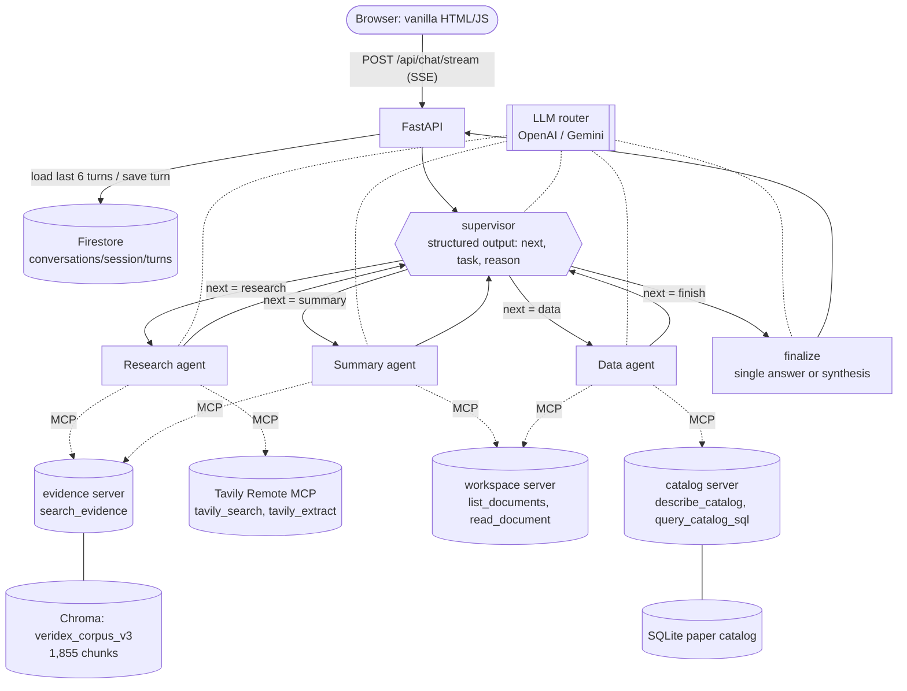

# Veridex v2 architecture

Veridex v2 is a multi-agent research assistant over 42 papers on LLM agents,
retrieval-augmented generation (RAG) and LLM evaluation. A LangGraph **supervisor**
routes each turn to three specialist agents (Research, Summary, Data). Every model call
is routed between **OpenAI `gpt-6.1-sol`** and **Google `gemini-3.8-flash`** by an
inspectable cost/capability router. Answers stream to a vanilla HTML/JS page over
Server-Sent Events, and conversations persist in Firestore.

Live service: <https://veridex-v2-596419356898.us-west1.run.app> (Cloud Run,
project `veridex-v2`, `us-west1`).

## Orchestration

Pattern: **Supervisor** (flat). The supervisor sees all three workers; each worker
returns to the supervisor, which either dispatches another worker or finishes.

Transitions are driven only by state fields: the supervisor writes `next`; a
conditional edge reads it. Workers always return to the supervisor. Three guards keep
the graph finite and robust:

- **Hop limit:** after `SUPERVISOR_MAX_HOPS` (3) worker runs, the supervisor finishes.
- **Repeat guard:** a worker that already succeeded this turn is never dispatched again.
- **Failure handling:** a worker that raises (provider down, tool failure, timeout) is
  recorded as `status=error` in `results`; the graph continues and the supervisor
  decides what to do. If the supervisor model itself fails, a deterministic keyword
  router chooses the worker. If every worker failed, finalize says so instead of
  guessing.

### State schema

`veridex.agents.state.SupervisorState` (LangGraph `TypedDict`):

| Field | Type | Scope | Meaning |
| --- | --- | --- | --- |
| `messages` | `list[AnyMessage]` (`add_messages`) | conversation | earlier turns replayed from Firestore + this question + the answer |
| `question` | `str` | turn | the current user message |
| `next` | `"research" \| "summary" \| "data" \| "finish"` | turn | the supervisor's latest decision |
| `task` | `str` | turn | self-contained instruction for the chosen worker (pronouns resolved) |
| `reason` | `str` | turn | one-sentence rationale shown in the UI trace |
| `direct_answer` | `str` | turn | supervisor reply when no worker is needed (greetings) |
| `hops` | `int` | turn | workers dispatched this turn |
| `results` | `list[WorkerResult]` (append, reset per turn) | turn | per worker: status, answer, sources, tool calls, routing, error, duration |
| `routing` | `list[RoutingDecision]` (append, reset per turn) | turn | every routing decision in order |
| `trace` | `list[dict]` (append, reset per turn) | turn | orchestration events for the UI |
| `answer`, `citations` | `str`, `list[dict]` | turn | final answer and the sources it actually cites |

Per-turn lists use a reducer that appends within a turn and resets when the service
sends `None` at the start of the next turn.

## Agents

Specialization is by distinct system prompt **and** distinct MCP tool access
(`veridex.agents.prompts`, `veridex.agents.tools`).

| Agent | Responsibility | MCP tools | Default model (rule) |
| --- | --- | --- | --- |
| Supervisor | choose the next worker or finish; resolve follow-ups | none (structured output only) | Gemini (`classify`) |
| Research | grounded answers with citations from the corpus and the live web | `search_evidence`, `tavily_search`, `tavily_extract` | Gemini (`single_lookup`) or OpenAI (`multi_step_synthesis`) |
| Summary | citation-preserving summaries of specific papers | `list_documents`, `read_document`, `search_evidence` | Gemini (`long_context`) or OpenAI (`cross_document`) |
| Data | structured questions about the corpus via SQL | `describe_catalog`, `query_catalog_sql`, `list_documents` | Gemini (`structured_lookup`), OpenAI after a failed query (`sql_repair`) |
| Finalize | return one worker's answer, or merge several | none | OpenAI (`multi_agent_merge`) when merging |

Each worker runs a bounded tool loop: at most 4 rounds and 6 tool calls, and the
model reads at most 8,000 characters per tool result (the full result is kept for
citations). Tool failures become error tool messages that cannot be cited.

## LLM routing

`veridex.llm.router` picks a provider per call from the agent and observable signals of
the question (`comparison`, `multi_part`, `needs_web`, `documents`, `escalate`). Every
decision records `provider`, `model`, `dimension`, `rule`, `reason` and the `signals`,
is streamed to the UI as a routing chip, and is stored in the trace.

| Agent | Rule | Signal | Provider | Dimension | Why |
| --- | --- | --- | --- | --- | --- |
| supervisor | `classify` | always | Gemini | cost | short classification |
| research | `single_lookup` | no comparison, multi-part or recency words | Gemini | cost | one grounded lookup |
| research | `multi_step_synthesis` | comparison, multi-part or recency | OpenAI | capability | multi-source reasoning |
| summary | `long_context` | one paper | Gemini | capability | long page text, large context window |
| summary | `cross_document` | two or more papers | OpenAI | capability | cross-paper synthesis |
| data | `structured_lookup` | first attempt | Gemini | cost | small schema, simple SQL |
| data | `sql_repair` | a SQL call failed | OpenAI | capability | error-driven repair |
| synthesis | `multi_agent_merge` | two or more workers answered | OpenAI | capability | merge with citations intact |

Routing is hybrid: cheap calls go to Gemini, reasoning-heavy calls to OpenAI.
**Fallback:** if a provider call fails, the same call is retried once on the other
provider and the decision is marked `fallback_from`; fallbacks are shown separately
from routing decisions. Temperature is left at provider defaults (GPT-6 rejects other
values). `ROUTER_FORCE_PROVIDER` exists only for the provider comparison in
[evaluation.md](evaluation.md).

## RAG pipeline

Details and rebuild commands: [corpus_v3.md](corpus_v3.md).

- **Corpus:** 42 arXiv papers (9 RAG/retrieval, 11 agent reasoning/tools, 10
  multi-agent systems, 12 evaluation), CC BY 4.0 or CC0 only, listed in
  `data/corpus_v3/papers.json`. Papers under arXiv's default license (e.g. the original
  RAG paper, DPR, Toolformer, MT-Bench) are covered through Tavily instead.
- **Ingestion (LangChain LCEL):** PyMuPDF page text → drop everything from the first
  `References` heading → `RecursiveCharacterTextSplitter.from_tiktoken_encoder`
  (400 tokens, 60 overlap, `cl100k_base`; pages split independently) → chunk IDs
  `<paper>:p<page>:c<index>`.
- **Storage:** `text-embedding-3-small` (1,536 dims) in Chroma collection
  `veridex_corpus_v3` (cosine), 1,855 chunks, baked read-only into the container image
  and verified at build time.
- **Retrieval:** `search_evidence` returns top-k passages (default k = 5, max 10,
  optional `document_id` filter); agents issue several focused queries per question.
- **Augmentation:** passages arrive as tool results (JSON with `chunk_id`, title, page,
  source URL, text) inside the agent's tool loop. The research prompt template is:
  *system:* role, tools, search budget, citation rules (`[chunk_id]` for corpus,
  `[title](url)` for web), untrusted-content rule → *history:* last turns →
  *user:* `User question: …\n\nYour task: …` → *tool results:* passages.
- **Generation with citations:** answers cite chunk IDs inline; `veridex.agents.citations`
  keeps only IDs that were actually retrieved in the turn and returns them with title,
  page, arXiv URL and snippet. The UI turns them into numbered chips; IDs not retrieved
  in the turn are shown as unverified.

## MCP tool sharing (A2A / MCP criterion)

Veridex takes the **MCP tool-sharing** path. Four MCP servers are connected through
`langchain-mcp-adapters` in one registry: three local STDIO servers (evidence,
workspace, catalog) and **Tavily Remote MCP** over Streamable HTTP with the API key as
the `tavilyApiKey` query parameter. Two tools are deliberately shared:

| Tool | Agents | Different contexts |
| --- | --- | --- |
| `search_evidence` | Research, Summary | Research answers questions; Summary finds the chunk that backs each summary point |
| `list_documents` | Summary, Data | Summary picks which paper to read; Data reports file-level details |

Rationale: one retrieval implementation (and one index) serves every agent, so
citations from different agents use the same chunk IDs and the same access controls,
while each agent's prompt decides how it uses the tool. The wiring is visible at
`GET /api/info` and in the UI side panel, where shared tools are outlined.

## Durable conversation state

The graph is stateless between turns. `veridex.state.store` persists each completed
turn (question, answer, cited source IDs, routing summary) and replays the latest 6
turns as messages at the start of the next turn, so follow-ups work on any instance.

| Backend | Where | Survives |
| --- | --- | --- |
| Firestore (`STATE_BACKEND=firestore`) | Cloud Run; `veridex_conversations/{session_id}/turns/{auto-id}` | restarts, scaling, revision rollout |
| SQLite (`STATE_BACKEND=sqlite`) | local development | restarts of one machine |
| memory | tests | nothing |

The Cloud Run runtime service account has only `roles/datastore.user` plus
`secretAccessor` on the three API-key secrets. Verified on the deployed service: after
rolling a new revision, a follow-up ("the first paper I asked about") was answered from
the turns stored in Firestore. Per-instance session locks prevent overlapping turns in
one session on the same instance.

## Streaming and frontend

`POST /api/chat/stream` returns `text/event-stream` events: `route` (each routing
decision as it is made), `trace` (each node), `token` (answer text from worker or
finalize nodes), `citations`, `done` (answer, routing, trace, token usage, cost, timing)
and `error`. The single page in `src/veridex/web/static` reads the stream with
`fetch()` and shows routing chips with reasons, a collapsible orchestration trace,
citation chips linked to a source list, and per-turn time to first token.

## Deployment

`deploy/cloud_run.sh` builds the image with Cloud Build and deploys Cloud Run with
2 GiB / 2 vCPU, concurrency 10, timeout 300 s, 0–3 instances, API keys from Secret
Manager and `STATE_BACKEND=firestore`. The container is a multi-stage
`python:3.13-slim` image installing `requirements.txt` (exact pins), running as a
non-root user, with the Corpus v3 PDFs, Chroma index and catalog checked by
`scripts/check_bundle.py` during the build. The three local MCP servers start as
child processes when the app starts (about 7 s locally).
